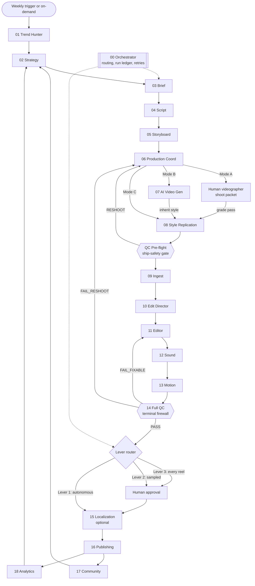

# Agentic Reel Studio (ARS)

**A multi-agent AI production system that takes a short-form video reel from strategy to publish-ready master, with a human approval gate wherever it matters.**

Designed and directed by **Jamila Howard** (AI systems builder, creative executive) for Sequel Digital Solutions, piloted on her personal brand REINVENTED. The specs, schemas, validators and runbooks in this repo were produced across a 100+ day build (April 20 to July 30, 2026), most of it in nightly autonomous build sessions run by Claude-based agents under her direction and review.

> This repository is the design and verification record: architecture, agent specs, JSON contracts, test fixtures, offline validators, LLM test runbooks, and dated build logs. It is not a hosted app. Each agent ships as a Claude skill bundle (`SKILL.md` system prompt + schemas + fixtures) that runs inside a Claude Code / Claude Agent SDK session.

---

## What it does

ARS replaces the roles of a full in-house reel team with specialized agents, each owning one link in the chain and handing off typed JSON to the next:

- **Pre-production:** trend scanning, weekly content strategy, creative brief, script, storyboard, production coordination
- **Production, in one of three modes:**
  - **Mode A** live shoot (agents brief a human videographer)
  - **Mode B** fully AI-generated (talent avatar, b-roll, voice)
  - **Mode C** style replication from a reference URL, with the brand's own voice layered on top
- **Post-production:** ingest, edit plan, edit, sound, motion graphics, QC
- **Distribution and learning loop:** localization, publishing, community listening, analytics that feed the next week's strategy

From Ingest onward the pipeline is **mode-blind**: A, B and C converge on one post-production path.

---

## Architecture



Source: [`docs/ARS-2026-04-24-Agent-Orchestration-Blueprint.md`](docs/ARS-2026-04-24-Agent-Orchestration-Blueprint.md) (runtime wiring, handoff contracts, trigger map, data-store contract) and the QC Pre-flight SPEC outline, which splits the earliest slice of QC into a gate at the production-to-post boundary.

### Data and tooling

| Layer | Used for |
|---|---|
| Claude (Opus-class models), Claude Code / Agent SDK skills | Every reasoning agent; runbooks execute fixtures through the model |
| JSON Schema Draft 2020-12 + Python `jsonschema` | Input/output contract per agent; offline validator harness per bundle |
| Notion | Human-facing records: Reel Pipeline and Trend Queue databases, approvals, QC scorecards |
| Drive | Media: raw footage, v1/v2/v3 edits, final masters |
| HeyGen, ElevenLabs, Runway / Sora / Veo class engines | Mode B talent, voice and b-roll generation |
| Ayrshare | Draft staging and publishing |

---

## Agent roster

The blueprint defines the runtime pipeline (18 roles plus an orchestrator). The build program numbers the agents it specs, in build order, as a 17-agent fleet. Both views are in the sources; this table maps them.

| Runtime role | Stage | Build # | Status (as of Jul 30, 2026) |
|---|---|---|---|
| 01 Trend Hunter | Pre-production | (live pipeline) | Trend Queue database feeds strategy |
| 02 Strategy | Pre-production | (live pipeline) | `reel-strategy` v1.0 finalized May 29 ([spec](specs/agents/ARS-2026-05-29-Agent-1-reel-strategy-v1.0.md)) |
| 03 Brief | Pre-production | #1 | **LOCKED** (Day 6) |
| 04 Script | Pre-production | #2 | **LOCKED** (Day 9) |
| 05 Storyboard | Pre-production | #3 | **LOCKED** (Day 14) |
| 06 Production Coord | Pre-production | #4 | **LOCKED** (Day 14) |
| 07 AI Video Gen | Production, Mode B | #5 | **LOCKED** (Jul 7) |
| 08 Style Replication | Production, Mode C | #6 | **LOCKED** (Jul 7) |
| QC Pre-flight gate | Production to post | #7 | **LOCKED** (Jul 7) |
| 09 Ingest | Post-production | #8 | **LOCKED** (Jul 7) |
| 10 Edit Director | Post-production | #9 | **LOCKED** (Jul 7) |
| 11 Editor | Post-production | #10 | **LOCKED** (Jul 7) |
| 12 Sound | Post-production | #11 | LOCK candidate; schemas, skill bundle and runbook complete |
| 13 Motion | Post-production | #12 | LOCK candidate; schemas, skill bundle and runbook complete |
| 14 Full QC | Post-production | #13 | LOCK candidate; schemas, skill bundle and runbook complete |
| 15 Localization | Distribution | #14 | SPEC outline (Jul 30) |
| 16 Publishing, 17 Community, 18 Analytics | Distribution / learning loop | #15 to #17 | Specified in the blueprint; not yet built |

---

## How each agent is built

Every agent goes through the same gated lifecycle, and each step is a dated file in this repo:

1. **SPEC outline** (sections 0 to 5: purpose, position, I/O skeleton, open questions)
2. **SPEC body**, in two partials (self-QC check list, system prompt, field map, error codes, decision walk)
3. **v1.0 LOCK candidate**: unified spec plus an 11-item reviewer checklist and a cross-spec audit
4. **Input/output schemas** (Draft 2020-12)
5. **Skill bundle**: `SKILL.md`, schemas, 5 test cases (happy paths plus adversarial failures), `validate.py`
6. **LLM test runbook**: paste-and-run execution of all 5 fixtures through the model; 5/5 required
7. **LOCK**: only on real 5/5 evidence, recorded in a ceremony record

---

## Design decisions

- **Typed contracts at every seam.** Every handoff is a JSON envelope (`meta` / `payload` / `checks`) carrying run id, mode, lever and attempt. Every agent output is `oneOf [success, errorEnvelope]` with named error codes, so failures are data, not prose.
- **Provenance by construction.** Each output carries a `parent_chain` tuple that grows one element per stage (QC Pre-flight 6, Ingest 7, Edit Director 8, Editor 9, Sound 10, and on). The cross-spec amendment that defines it was ratified Jul 7; schemas hold an additive floor until the live pipeline emits full-length tuples, with the exact-length tightening scheduled as a separately validated migration.
- **Defense-in-depth brand firewall.** Entity restrictions, banned vocabulary and internal tool names are re-checked at every stage, not only at the end. QC Pre-flight is the production-side gate, Full QC is the terminal firewall on the master, and Localization scans only the new caption text it authors.
- **Human-in-the-loop as a dial, not a switch.** Lever 3 (human approves every reel), Lever 2 (sampled), Lever 1 (autonomous). Graduation is earned: 30 reels at quality to move from 3 to 2, 90 reels without intervention to move from 2 to 1. Regardless of lever, firewall hits, missing truth echoes, banned vocabulary and reshoot verdicts always escalate to a human. The pilot was held at Lever 3 by owner decision on May 22.
- **Executors vs adjudicators.** Creative judgment lives in a small number of named slots. The Editor, for example, is a faithful executor with two verdicts only (`edl_ready | fail`); the judgment sits one stage upstream in the Edit Director.
- **Mode-blind post-production.** Mode A, B and C converge at Ingest; downstream agents self-attest that they never read `production_mode`.
- **Failure classes with different handling.** Transient (exponential backoff, max 4 tries), content (route back upstream with a fix note, max 2 cycles), structural (hard stop, blocker log, escalate).
- **Versioned canon.** Every reel record pins the `brand_voice_version` it was produced against; interface changes follow patch / minor / major rules with validator regeneration.
- **No fake progress.** Unattended sessions run at a zero-spend ceiling with dry-run engine stubs. A LOCK requires a live 5/5 runbook run; when that run cannot happen, the agent stays a candidate and the build log says why.

---

## Status

- **Fleet LOCK state:** agents #1 to #10 LOCKED. The Jul 7 ceremony locked #5 to #10 on 240/240 validator checks ([record](build-log/ARS-2026-07-07-LOCK-DAY-Ceremony-Record.md)). Sound, Motion and Full QC are LOCK candidates whose remaining gate is a live runbook run.
- **Offline validation:** 13 skill bundles; the 9 bundles with validator harnesses pass **557/557** checks (reproduced on this repository before publishing).
- **Live pipeline:** The first end-to-end test run (a salon client hiring reel) ran May 10 with the Lever 3 gate holding. The AI-twin render recipe was approved June 11 after four takes, and Notion records the pipeline live with its first full weekly batch on June 20, 2026. The weekly batch writes scripts and captions, renders, and stages drafts for approval. Nothing auto-posts.
- **Next:** Localization SPEC body, then Publishing, Community and Analytics.

---

## Repository map

```
docs/        concept blueprint, orchestration blueprint, milestone plan, competitor scan,
             brand voice intake, cross-spec consistency review
specs/
  agents/    dated SPEC outlines, body partials, LOCK candidates, v1 specs
  schemas/   dated input/output JSON schemas per agent
  skills/    one skill bundle per agent (SKILL.md, schemas/, test-cases/, validate.py)
  fixtures/  historical AI Video Gen schema dry-run fixtures (Day 25)
runbooks/    LLM test runbooks (paste-and-run, 5 fixtures each)
build-log/   daily build logs, rest-day primers, LOCK Day ceremony record
```

File names keep their original dates. Commit history follows those dates.

### Run the validators

```bash
python3 -m pip install "jsonschema>=4.18"
for v in specs/skills/*/validate.py; do (cd "$(dirname "$v")" && python3 validate.py | tail -1); done
```

---

## Notes on this public edition

- Third-party organization names, people's names, addresses and contact details in the source specs were replaced with neutral placeholders (for example `Holdco`, `SLN`, `NPOX`, `Principal`). The replacement is consistent across specs, fixtures and validators, so the firewall tests still exercise real detection logic and still pass.
- Commercial pricing and client-specific materials were withheld. Engine unit costs used in cost-ceiling logic were kept because the specs depend on them.
- Local machine paths and notification numbers were removed.

Contact: jamilahoward@gmail.com
